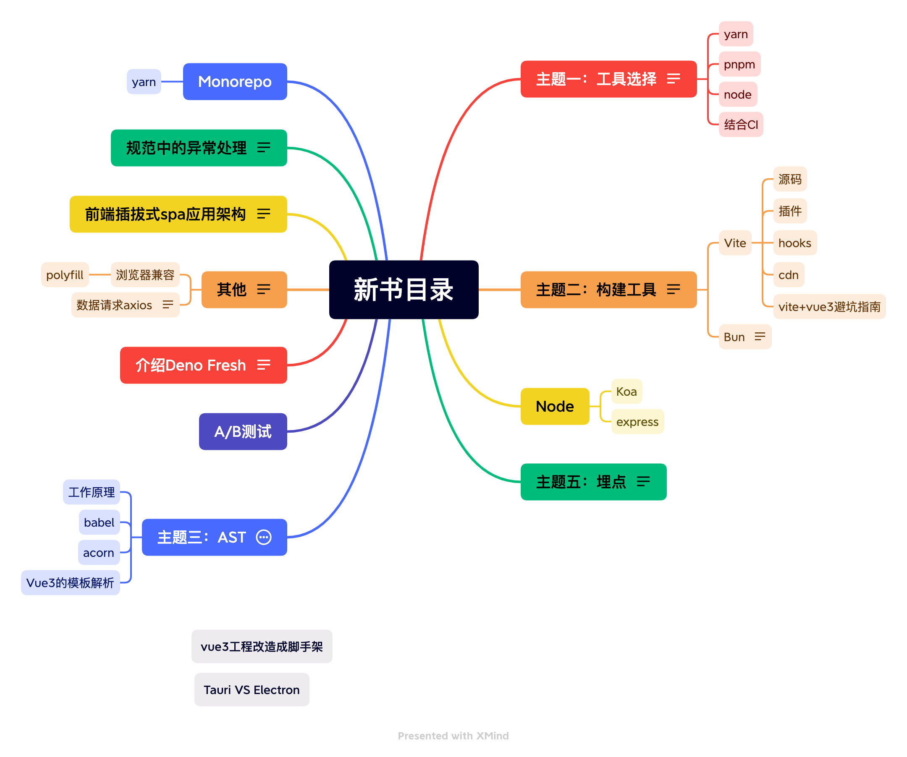

## front-end-beautifier-in-process
让前端开发更美好

### 进度

| Note:  |
| :----- |
| 进行中 |

### 计划

| 章节  | 开始时间 | 结束时间 | 当前状态 | 是否有延期 | 计划完成 | 第二轮润色| 计划完成 |
|:---:| ---- | ---- | ---- |:-----:|:-----:| :-----:| :-----:|
| 第1章 |      |      |   已完成   |  -  | - | 已开始  |4-14 |
| 第2章 | - |      | 已完成  |   -   |  - | 4-14  | 4-15  |
| 第3章 | - |     |   已完成  |  -  |   -  | -  | 4-24  |
| 第4章 |   |  | 已完成 |   |  - | -  | 4-30  |
| 第5章 |  |  | 已完成  | -     |  -  | -  | -  |
| 第6章 |  |  |  已完成| -    |  - | -  | 5-13  |
| 第7章 |      |   |   已完成   |  -  | - | -  |-  |
| 第8章 | - |      | 已完成  |   -   |  - | -  | -  |
| 第9章 | - |     |   已完成   |  -  |   -  | -  | -  |
| 第10章 |   |  | 已完成 | -    |  - | -  | -  |
| 第11章 |  |  | 已完成 | -     |  -  | -  | -  |
| 第12章 |  |  | 已完成 | -    |  - | -  | -  |

## 简版目录

## 详细目录
[具体目录](./category.md)
